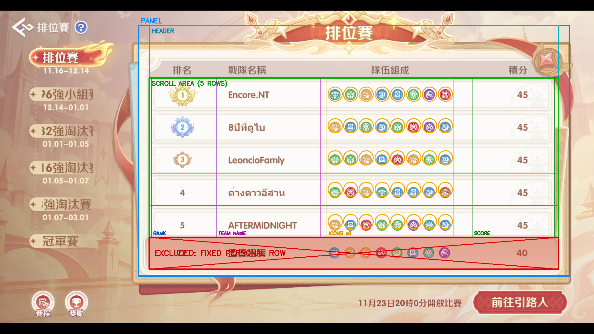
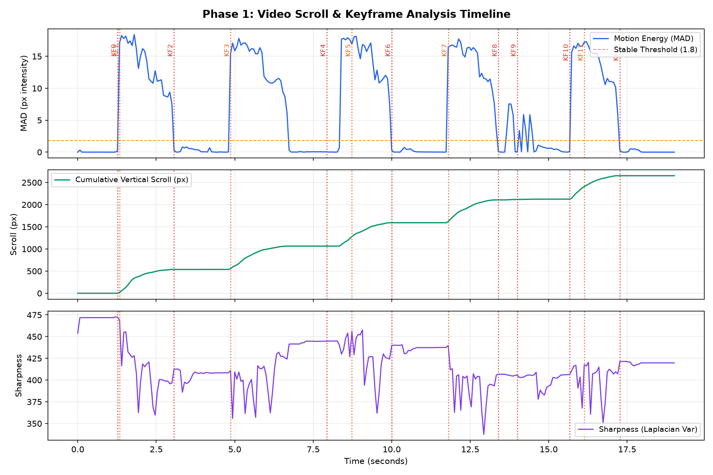

# Stage 1 深度學習筆記：影片分析、捲動追蹤與自動 ROI 定位

這份筆記對應 **Stage 1** 的所有實作，以你的實測影片 `2026-11-21 03-18-43.mp4`（1920×1080、60 FPS、19.05 秒）為真實教材，拆解背後的電腦視覺（Computer Vision）原理與工程取捨。

---

## 1. 先建立心智模型：影像在 OpenCV 裡是什麼？

在 C# 中你可能習慣把圖片當成 `Bitmap` 物件呼叫 `GetPixel(x, y)`；但在 Python + OpenCV 的世界裡，**一張圖片就是一個三維的 NumPy 數值矩陣**：

```text
frame.shape == (1080, 1920, 3)
                 │      │   └─ 3 個色彩通道：注意 OpenCV 預設是 BGR，不是 RGB！
                 │      └───── 寬度 W（X 軸，由左到右 0..1919）
                 └──────────── 高度 H（Y 軸，由上到下 0..1079）
```

因此**裁切畫面（ROI, Region of Interest）**不需要呼叫複雜的 API，只要用陣列切片（Slicing）就能以零拷貝（View）方式完成：

```python
# 對應 src/layout/detector.py -> Box.crop()
crop = img[y1:y2, x1:x2]  # 注意順序是 [Y 範圍, X 範圍]，不是 [X, Y]！
```

### 為什麼掃描整部影片要「循序 `cap.read()`」而不是一直 `cap.set(POS_FRAMES)`？
MP4（H.264）壓縮影片中，只有少數影格是完整畫面（**I-frame / 關鍵幀**），中間多數影格只存「跟上一張的差異」（**P-frame / B-frame**）。
- 隨機跳轉 `cap.set()` 時，解碼器必須退回前一個 I-frame 重新解碼到目標幀，速度慢且偶爾有 1～2 幀偏差。
- 因此在 `src/video/keyframes.py` 中，**Pass 1 掃描運動曲線一律用循序 `cap.read()` 搭配 `stride` 抽樣**，既快又準；只有在最後確定好少數候選影格後，才回頭讀取完整彩圖。

---

## 2. 自動偵測排行榜 ROI 與「雙重保護」排除固定個人列



如果把座標寫死成 `y=252..767`，只要下次 OBS 錄成視窗模式、稍微縮放或換螢幕解析度就會整個切歪。我們的解法分四步（實作於 `src/layout/detector.py`）：

### Step 1：為什麼先轉成 HSV 色彩空間，而不用 RGB？
在 RGB 中，要描述「明亮的羊皮紙白底」或「暖米黃色個人列底色」非常麻煩，因為光線稍微變暗，R、G、B 三個數值會同時改變。
轉成 **HSV** 後，三個通道各司其職：
- **H（Hue 色相）**：是什麼顏色（紅/黃/綠/藍…）
- **S（Saturation 飽和度）**：顏色有多鮮豔（白/灰幾乎是 `0`，鮮豔圖示 `> 65`）
- **V（Value 明度）**：有多亮（白底 `> 230`）

有了 HSV，實測影片裡的區塊瞬間界線分明：
- **捲動區白底**：低飽和＋高明度（`S < 25, V > 230`）
- **最底部的固定個人列（第 72 名）**：明顯偏暖米黃色（**`S ≈ 47.6`**，明顯高於捲動區的 `S ≈ 15～20`）
- **8 個職業圖示**：高飽和度彩色圓徽（**`S > 65`**）

### Step 2：用「跨影格時間變異（Temporal Std）」做雙重保險
我們從影片均勻抽 16 張影格堆成 4D 陣列 `(16, H, W, 3)`，計算每一條水平掃描線 `y` 隨時間變化的標準差 `tstd_y`：
- **表頭區（`y < 252`）**：不動 → `tstd ≈ 0.6～1.8`
- **5 列捲動區（`y = 252..767`）**：隊伍不斷捲過去 → **`tstd ≈ 7.4～20.2`**
- **固定個人列（`y = 767..870`）**：捲動時完全不動 → **`tstd = 0.44`**，且 **`S = 47.6`**

結合 **「時間上完全靜止」＋「色彩上為暖米色」** 兩個完全獨立的證據，就能極度穩健地鎖定捲動區並把個人隊伍列（上圖紅色打叉區）完全排除！

### Step 3：用「一維投影」自動找出 8 個職業圖示的 X 座標
在捲動區內，統計每個 X 座標上有多少比例的像素屬於高飽和度（`S > 65`）：
- 排名、戰隊名稱、積分都是深棕色文字（低飽和度），只有 8 個彩色職業圓徽是高飽和度。
- 把 2D 畫面沿 Y 軸取平均壓縮成 1D 曲線後，會自然長出 **8 個等間距的尖峰**（實測平均寬度 `33.9 px`、中心間距 `50.9 px`）！
- 最後全部轉成**相對於主框的 `0.0～1.0` 比例座標**存入 `layout.json`，就算換解析度或縮放也能等比例適應。

---

## 3. 為什麼不用固定時間截圖？拆解自適應選幀演算法



觀察上面這張從你的實測影片真實畫出來的三層時間軸，每個演算法的作用一目了然：

### ① 運動能量 MAD（上圖藍線）
計算前後兩張抽樣影格在捲動區內的平均絕對像素差（Mean Absolute Difference）：
$$\text{MAD}(t) = \frac{1}{N}\sum |I_t(x,y) - I_{t-1}(x,y)|$$
- **低於黃色虛線（`1.8`）**：代表玩家停下來看榜單（**Stable Segment 穩定停頓段**）→ 畫面完全無動態模糊！
- **飆升到 `10～18`**：代表正在捲動（**Scrolling Segment**）。

### ② 相位相關 `cv2.phaseCorrelate`（中圖綠線）
怎麼知道畫面「往上捲了多少像素」？
- **原理**：如果圖片 B 是圖片 A 往下平移 `dy` 像素，兩張圖經過**二維傅立葉轉換（FFT）**後，頻率域的相位差會直接對應成一個尖銳的脈衝峰值，峰值的位置就是 `(dx, dy)`！
- **為什麼要乘上 Hanning Window（漢寧窗）？** 因為圖片上下邊緣在捲動時會不斷有新列滑進來、舊列滑出去，會產生邊界假訊號；漢寧窗把邊緣權重平滑降到 0，讓演算法專注比較中間重疊的內容。
- **看實測成果**：中圖綠線呈現非常漂亮的階梯狀——每一階剛好上升 **`~530 px`**（正好是 5 列 × ~104 px），6 個平台剛好完整對應第 1～30 名！

### ③ Laplacian 銳利度（下圖紫線）
Laplacian 算子是圖片的**空間二階微分**（用來抓邊緣與細節變化）：
- 文字與圖示越銳利，邊緣數值跳動越大，**方差（Variance）越高**（實測靜止時 `410～472`）。
- 一旦捲動產生殘影模糊，邊緣變糊，方差立刻往下掉（實測捲動時掉到 `340～365`）。

### ④ 時間中位數合成（Temporal Median Composite）—— 消除滑鼠游標的黑魔法
在一個穩定停頓段內，如果我們取 3～5 張對齊的靜止影格，對每一個像素位置取**中位數（`np.median`）**：
- 背景、文字、職業圖示在 5 張圖裡都一樣 → 中位數仍是原本清晰的文字與圖示。
- 滑鼠游標如果短暫滑過某個職業圖示（只在 5 張中的 1～2 張出現）→ **取中位數時會被自動濾掉，游標直接從畫面上消失！**

---

## 4. 真實工程調參紀錄（從實測圖發現問題）

這也是做 CV 專案最重要的習慣——**一定要把中間過程視覺化出來看！**

在第一版程式跑完實測影片時，我們原本設定「捲動中每移動 `0.65 列` 就抓一張安全影格」，結果從時間軸圖立刻發現兩個問題：
1. 兩次停頓之間才捲了 1 頁（5 列），`0.65 列` 的設定卻在每次翻頁途中多抓了 6 張正在移動的影格，讓 19 秒影片抓出多達 **38 張** 影格（後面 OCR 會白做 3 倍工）。
2. 在第 13.5～15.5 秒（第 5 個平台）時，玩家沒捲動但晃動了滑鼠，MAD 短暫跳到 `5～7`，導致同一個畫面被重複存成兩張影格。

**調整方式**：
- 把連續捲動補幀門檻 `scroll_step_row_fraction` 調成 **`3.0 列`**（因為一次看得到 5 列，每移動 3 列才補 1 張就能保證仍有 2 列重疊、絕不漏隊，又大幅砍掉多餘移動幀）。
- 把相鄰關鍵影格視覺去重門檻 `min_visual_diff_mad` 調成 **`3.5`**（晃滑鼠造成的全表 MAD `< 1.0`，而捲動 1 列 MAD `> 12.0`，輕鬆區分）。

---

## 5. Python × C# 快速語法對照（本階段用到）

| C# 概念 | Python 寫法（本專案範例） | 所在檔案 |
| :--- | :--- | :--- |
| `public record VideoMetadata(...)` | `@dataclass(frozen=True)` | `src/video/loader.py` |
| `Path.Combine(a, b)` | `Path(a) / b`（`pathlib` 運算子重載） | `src/config.py` |
| `using (var cap = ...)` | `try: ... finally: cap.release()` | `src/video/loader.py` |
| `arr.Where(x => x > 3.5)` | `mask = smooth_tstd > 3.5`（向量化布林遮罩，底層跑 C 迴圈超快） | `src/layout/detector.py` |
| `LINQ MaxBy(x => x.Sharpness)` | `max(loaded, key=lambda x: x[2])` | `src/video/keyframes.py` |

---

## 6. 關鍵程式碼閱讀順序與思考題

建議依序打開這 4 個檔案對照上面的原理解說：
1. `src/video/loader.py` — 影片唯讀載入與均勻抽樣
2. `src/layout/detector.py` — HSV＋時間變異自動定位 ROI 與個人列排除
3. `src/layout/slicer.py` — 用 8 個彩色圖示當錨點切出完整可見列（自動跳過上下被裁半的列）
4. `src/video/keyframes.py` — 運動分析、相位相關捲動追蹤、時間中位數去游標與時間軸繪圖

**小思考題（等你進 Stage 2 前可以想想看）**：
> 如果未來錄製 200 隊時，玩家有一段**完全不停頓、一口氣勻速往下滑 30 隊**，我們的 `keyframes.py` 會走哪一條分支？`slicer.py` 又怎麼避免把最上面/最下面滑到一半的半截隊伍切進來？
