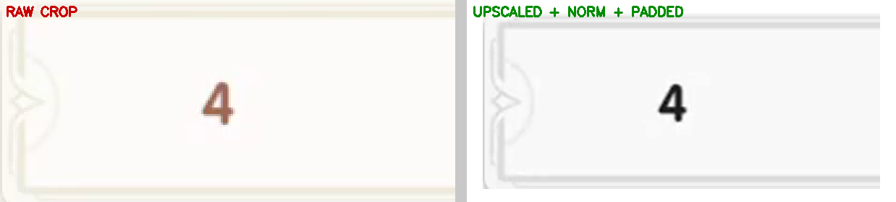
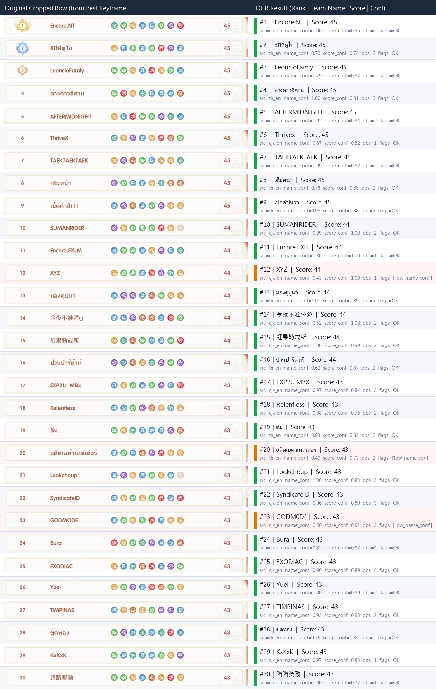

# Stage 2 深度學習筆記：多語系 OCR、徽章分類與跨影格去重稽核

這份筆記對應 **Stage 2** 的所有實作，以實測影片中第 1～30 名的真實擷取結果為案例，拆解「為什麼不能把截圖直接丟 OCR？」以及「如何用跨影格共識與業務規則，把辨識系統做成可控、可稽核的工程管線」。

---

## 1. 為什麼不要直接把整張圖丟給 OCR？

新手做 OCR 最容易踩的坑，就是把整張 1920×1080 截圖丟給 OCR 套件。實際上會同時遇到四個災難：
1. **欄位錯位**：戰隊名稱太長或太短時，很難從一堆零散文字框還原「哪個數字是誰的積分」。
2. **第 1～3 名根本不是純文字**：它們是金、銀、銅三款**造型徽章**，一般文字 OCR 辨識率極不穩定。
3. **小字號數字誤判**：原圖的排名 `4` 高度只有十幾個像素，直接丟模型容易漏偵測或看成英文字母。
4. **多語系衝突**：榜單同時混有**繁/簡中文、英文、泰文**，單一 EasyOCR 模型無法同時支援繁中與泰文。

因此我們的設計原則是：**「先分欄裁切（Phase 1）→ 依欄位性質走專用管線 → 跨影格投票融合 → 業務規則自動抓錯」**。

---

## 2. 四條專用辨識管線解析

### ① 第 1～3 名徽章分類器（`src/ocr/rank_badge.py`）
觀察排名欄：第 4 名起是深棕色純文字（低飽和度像素佔比 `< 0.015`），而第 1～3 名是大塊彩色徽章（飽和像素佔比 `> 0.035`）。

我們在 HSV 空間用「兩階段判斷」：
1. **門檻分流**：飽和像素比例 `< 0.035` → 判定為純數字，交給數字 OCR；`>= 0.035` → 判定為徽章。
2. **色相＋寬度區分金 / 銀 / 銅**：
   - **第 2 名（銀藍花環）**：藍色系色相 `H ∈ [92, 140]` 佔比極高，一眼分出。
   - **第 1 名（金翅徽章） vs 第 3 名（古銅盾牌）**：結合「黃金色相比例（`H ∈ [19, 42]`）」、「平均明度 `V > 200`」與「水平張開寬度（翅膀明顯更寬）」做綜合評分，實測第 1、2、3 名辨識信心度高達 **`0.99`**！

### ② 數字欄位前處理（`src/ocr/text_ocr.py` -> `preprocess_for_digits`）

對排名（4+）與積分欄，我們在送入 OCR 前做了四個關鍵小動作：
1. **轉灰階** + **雙三次插值放大 2.6 倍**（讓筆畫變粗且平滑，OCR 的捲積網路最愛這個尺寸）。
2. **對比度正規化（`cv2.normalize`）**：把原本柔和的淺棕色字拉成純黑字配純白底。
3. **四周補白邊（`cv2.copyMakeBorder`）**：文字如果貼近圖片邊緣，EasyOCR 的文字偵測器（CRAFT）常會漏掉；補一圈白邊立刻穩很多。
4. **字元白名單（`allowlist="0123456789"`）**：強制模型只能輸出數字，根除把 `0` 誤認成 `O`、把 `1` 誤認成 `l` 或 `I` 的問題。

### ③ 中 / 英 / 泰多語系路由（`MultilingualOcrEngine.read_team_name`）
EasyOCR 的繁體中文模型（`['ch_tra', 'en']`）與泰文模型（`['th', 'en']`）各自獨立。我們用**兩段式路由**兼顧速度與準確率：
1. **快速通道**：先跑 `ch_tra + en`；如果結果是乾淨的純英文/數字（如 `Encore.NT`、`SUMANRIDER`）且信心度 `>= 0.72`，直接結束，省下一半時間！
2. **泰文路由與實測踩坑修正**：
   - 若信心度偏低或含有非 ASCII 字元，再補跑 `th + en`。
   - **真實踩坑紀錄**：第一版我們單純比較兩者信心度，結果發現英文隊名如 `GODMODE`、`Bura`、`XYZ` 在 `ch_tra` 信心度剛好低於 0.72 時，被 `th_en` 搶走並轉成了小寫（`godmode`、`bura`、`xxz`）！
   - **修正原則**：只有當 `th_en` **真的辨識出泰文字元（Unicode `\u0e00-\u0e7f`）** 時，才允許它勝出；純英數永遠保留 `cjk_en` 的大小寫精準度！

---

## 3. 跨影格融合與「業務防呆稽核網」（`src/ocr/deduplicator.py`）

同一支隊伍在捲動過程中往往會出現在 **2～4 張不同影格**裡。這不是浪費，而是把單幀準確率推向極致的黃金機會：

1. **同影格鄰列推算（Sequence Majority Vote）**：
   - 同一張畫面的 5 列，排名一定是嚴格連續整數（`r, r+1, r+2, r+3, r+4`）。
   - 如果其中 1 列剛好被游標擋到導致排名 OCR 失敗，我們用其他 4 列的基準值 `rank - row_index` 投票，直接反推缺失排名並標記 `rank_inferred` 提醒人工覆核。
2. **8 圖示色彩簽章防撞（Icon Signature Conflict Check）**：
   - 合併同一個排名的多次觀測前，先比對兩張影格中這 8 個職業圖示的 HSV 直方圖餘弦相似度。
   - 若相似度 `< 0.72`，代表其中一張其實把別的排名誤認成了這一名，立刻攔截並寫入 `rank_conflict` 警告，絕不亂蓋資料！
3. **跨影格共識投票＋逐格去游標**：
   - 積分與隊名採**信心度加權投票**（靜止停頓影格權重高於捲動中影格）。
   - 8 個職業圖示在出現 3 次以上時，每個槽位各自挑出「最接近中位數」的那一張，自動濾掉單幀滑鼠遮擋。
4. **用遊戲本身的「不變量（Invariants）」當自動稽核網**：
   - **連續性檢查**：檢查 `1..max_rank` 是否缺號（缺任何一號立刻列入 `missing_rank` 錯誤，絕不虛報 200 隊完整）。
   - **積分單調遞減檢查**：排行榜的積分必然滿足 $\text{Score}(r) \le \text{Score}(r-1)$。一旦出現第 18 名積分比第 17 名高，馬上抓出 OCR 誤判寫入 `score_monotonicity` 錯誤！

---

## 4. 實測影片意外發現（看視覺化檢查表的威力！）

檢查上面的 `ocr_grid.png` 時，我們肉眼立刻發現一個**原本規格裡沒寫到、但對 Stage 3 至關重要的現象**：
- **第 10 名 `SUMANRIDER` 與第 21 名 `Lookchoup` 的第 8 個職業欄位是空的（淺米灰圓形空位）！**
- 換句話說，實戰中有些隊伍只有 7 人（未滿 8 人）。如果 Stage 3 沒先偵測並標記「空位」，空位就會被硬塞進某個職業分群裡污染統計！這正是「每階段都要視覺化驗證」帶來的真實價值。

---

## 5. Python × C# 快速語法對照（本階段用到）

| C# 概念 | Python 寫法（本專案範例） | 所在檔案 |
| :--- | :--- | :--- |
| `Lazy<T>` 延遲載入單例 | `@property` 搭配 `if self._reader is None:` | `src/ocr/text_ocr.py` |
| `Dictionary<int, List<T>>` 自動初始化 | `defaultdict(list)` / `Counter()` | `src/ocr/deduplicator.py` |
| `Regex.IsMatch(...)` | `re.compile(r"[\u0e00-\u0e7f]").search(txt)` | `src/ocr/text_ocr.py` |
| `list.OrderByDescending(x => (a, b))` | `list.sort(key=lambda o: (a, b), reverse=True)`（Tuple 字典序排序） | `src/ocr/deduplicator.py` |

---

## 6. 關鍵程式碼閱讀順序
1. `src/ocr/rank_badge.py` — HSV 色相＋寬度辨識第 1～3 名徽章
2. `src/ocr/text_ocr.py` — 數字前處理、白名單與中/英/泰雙模型路由
3. `src/ocr/deduplicator.py` — 鄰列排名推算、圖示簽章防撞、跨影格投票與單調性稽核
4. `src/pipeline_phase2.py` — Phase 2 串接與視覺化對照表產生器
