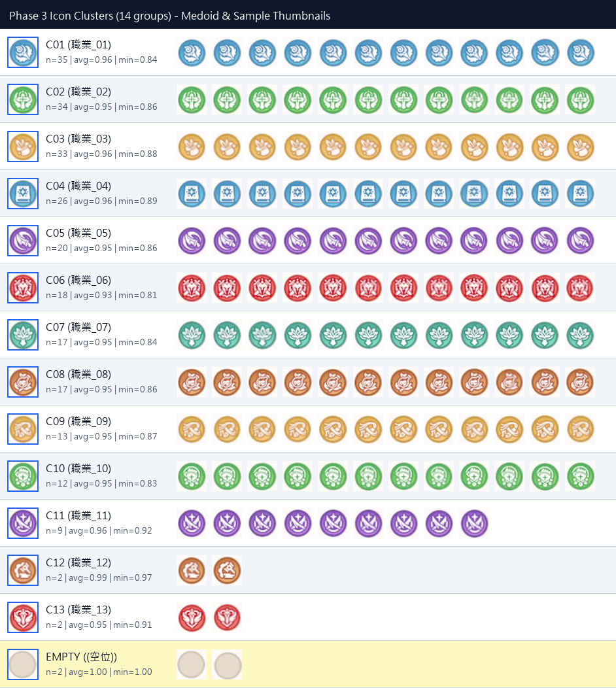
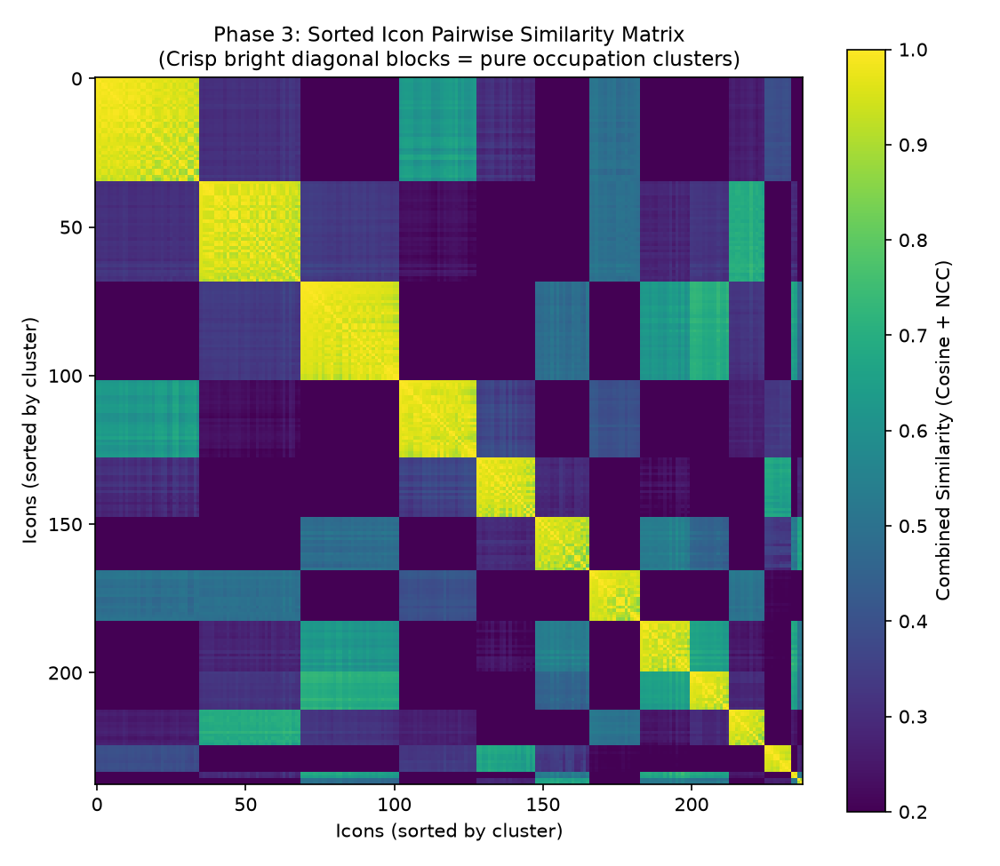

# Stage 3 深度學習筆記：免訓練圖片分類、特徵工程與職業圖示資料庫

這份筆記對應 **Stage 3** 的所有實作，以你實測影片中裁出的 **240 個職業圖示（30 隊 × 8 槽位）** 為真實樣本，解析「為什麼不需要訓練深度學習模型，就能做出接近 100% 純度的圖片分群與跨影片自動辨識」。

---

## 1. 為什麼不用訓練 CNN / YOLO，而用「經典特徵工程＋層次分群」？

許多人聽到「圖片分類」第一個念頭是標註幾百張圖、訓練深度學習模型。但對於遊戲 UI 的**固定尺寸圓形職業圖示**，經典特徵工程反而有壓倒性優勢：
1. **零訓練資料門檻**：第一次拿到新遊戲或改版新增職業，完全不需要事先標註訓練集，系統會自動把長一樣的圖示分在同一群，你只要看一眼群組幫它取名字即可。
2. **極快（免 GPU）**：處理 240 個圖示（甚至 200 隊 = 1,600 個圖示）在 CPU 上只需要 **1～2 秒**。
3. **完全可解釋、好除錯**：每張圖為什麼分在這群，都能直接看它的色彩與結構相似度分數（`0.00～1.00`），不像黑盒子模型出錯時不知從何查起。

---

## 2. 四個關鍵步驟拆解（`src/icons/features.py`）

### Step 1：空位偵測（Empty Slot Detection）
在 Stage 2 檢查原圖時我們發現：第 10 名與第 21 名只有 7 個人，第 8 格是淡米灰色的**圓形空位**。
- 正常職業圖示：高飽和度彩框（`S > 55` 佔比高）＋ 內部白色徽章邊緣銳利（Laplacian 方差高）。
- 空位圓框：平均飽和度極低（`< 28`）且內部平滑無紋理。
- 先把空位挑出來標記為 `(空位)`，後續統計就不會被髒資料污染！

### Step 2：質心對齊（Centroid Alignment）與圓形遮罩（Circular Mask）
裁切出來的圖示有時候會偏移 1～3 個像素（例如捲動微差），若直接逐像素比對，只要偏 2 個像素相似度就會暴跌。
- 我們先找出前景圖示像素的**重心（Centroid）**，把圓心重新置中並統一縮放成 **`40 × 40`**。
- 再套上**圓形布林遮罩（半徑 `r = 17 px`）**，把四個角落的白底與相鄰邊線通通忽略。

### Step 3：為什麼不能只靠「顏色直方圖」？（多線索特徵融合）
看實測影片的圖示會發現：遊戲裡**同色系但不同圖案**的職業不只一種（例如有好幾種藍色圓徽：海浪、法書、冰晶；好幾種綠色圓徽：樹葉、盾牌）。
如果只看顏色直方圖，所有藍色職業會全部混成同一群！

因此 `analyze_icon()` 把三種互補的視覺線索串接成一條長度約 700 維的單位向量（L2 Normalized）：
1. **外環 vs 核心 HSV 直方圖（Ring & Core Histogram）**：外環（`r ∈ [11, 17]`）抓職業底色系，內核（`r < 11`）抓白色徽章佔比。
2. **Lab 色彩空間 `a, b` 空間圖（`16 × 16`）**：Lab 空間比 RGB 更貼近人眼色差，保留色彩在空間上的分佈。
3. **歸一化灰階圖案（`20 × 20`）＋ Sobel 邊緣梯度強度**：專門抓中間**白色圖騰的形狀**（樹葉 vs 法書 vs 弓箭 vs 骷髏），讓「同色不同職業」拉開巨大距離！

最後計算兩張圖示的綜合相似度時，將**特徵向量餘弦相似度（權重 0.55）**與**遮罩內像素級歸一化互相關 NCC（權重 0.45）**結合：
$$\text{Sim}(A, B) = 0.55 \cdot \cos(\mathbf{f}_A, \mathbf{f}_B) + 0.45 \cdot \text{NCC}(A, B)$$

---

## 3. 無監督分群：層次式分群（Agglomerative Clustering）與 Medoid

### 為什麼選「層次式分群（Average Linkage）」而不是 K-Means？
- **K-Means 需要你事先猜出有幾種職業（`K` 值）**——但這部影片可能出現 12 種職業，下季改版可能出現 16 種！
- **層次式分群（`AgglomerativeClustering`）只需設定「距離門檻（`distance_threshold = 0.22`，即相似度 `>= 0.78`）」**，演算法會由下而上把距離小於門檻的圖示逐層合併，自動決定群組數量。
- 觀察上面的 **相似度熱力圖（`similarity_matrix.png`）**：把所有圖示依照分群結果重新排序後，對角線上出現一塊塊非常鮮明銳利的亮黃色方塊（群內相似度 `~0.90–0.99`），方塊以外全是深藍/深紫（群間相似度 `< 0.55`）——這就是「特徵設計成功、分群純度極高」最直觀的幾何證明！

### 什麼是 Medoid（中心點代表圖）？
每個群組我們不是算「平均圖」（平均起來會變模糊），而是挑出**跟同群其他所有成員平均相似度最高的那一張真實圖示（Medoid）**當作該群的代表圖，並把**群內相似度最低的幾張邊緣樣本**排在預覽列尾端，讓你在人工確認介面一眼就能揪出有沒有混進異常圖示！

---

## 4. 跨影片複用閉環（`src/icons/database.py`）

1. 你在網頁介面把每個分群命名（例如 `主教`、`盧恩`、`咒術`…）並按下儲存後，系統會從每個職業挑出最多 5 張最清晰的 `40 × 40` 標準模板，存入 `data/icon_db/catalog.json` 與 `data/icon_db/templates/`（體積不到 100 KB，隨 Git 版控）。
2. 下次分析新影片時，Phase 3 會**先跟 `icon_db` 比對（門檻 `>= 0.84`）**：
   - 已知職業直接自動命名，不用再人工確認！
   - 只有未來改版新出的職業或極少數低信心圖示，才會進入未知分群請你補命名並增量寫回資料庫。

---

## 5. Python × C# 快速語法對照（本階段用到）

| C# 概念 | Python / NumPy 寫法（本專案範例） | 所在檔案 |
| :--- | :--- | :--- |
| 雙層迴圈算 N×N 相似度矩陣 | `feat_sim = feats @ feats.T`（一行矩陣乘法算出 240×240 = 57,600 對餘弦相似度！） | `src/icons/clusterer.py` |
| 2D 座標遮罩判斷圓內像素 | `yy, xx = np.ogrid[:N, :N]; mask = (xx-c)**2 + (yy-c)**2 <= r**2` | `src/icons/features.py` |
| 取陣列最大值索引 | `int(np.argmax(mean_per_member))` | `src/icons/clusterer.py` |

---

## 6. 關鍵程式碼閱讀順序
1. `src/icons/features.py` — 空位偵測、圓心對齊、多線索特徵向量與 NCC 相似度
2. `src/icons/database.py` — `data/icon_db/` 模板資料庫讀寫與比對
3. `src/icons/clusterer.py` — 矩陣化相似度計算、層次分群與 Medoid 挑選
4. `src/pipeline_phase3.py` — Phase 3 串接、群組視覺檢查表、相似度熱力圖與人工命名回寫
