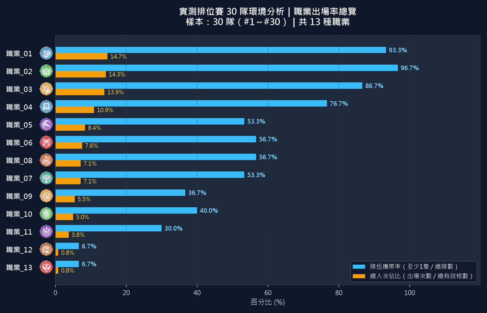
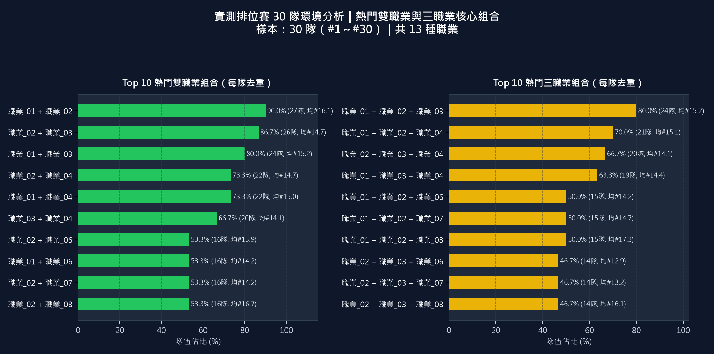
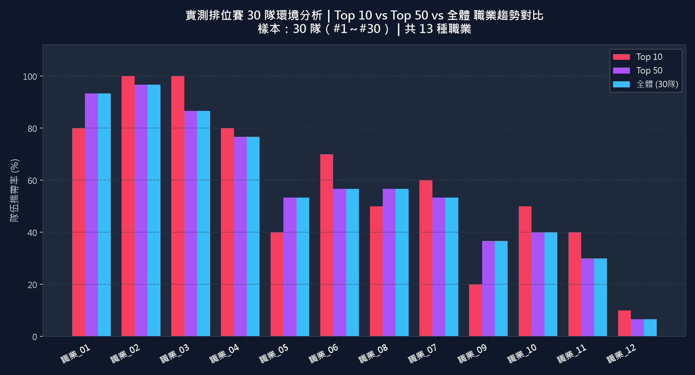

# Stage 4 深度學習筆記：雙指標環境分析、組合統計與分享報表工程

這份筆記對應 **Stage 4（統計分析引擎＋7 頁 Excel＋全配分享包）** 的所有實作，解析我們如何把原始辨識資料轉化成對公會／隊友真正有決策價值的 Meta 分析報告。

---

## 1. 為什麼「出場率」一定要分開算兩個指標？

在 8 人一隊且**允許同隊帶重複職業**的遊戲裡，如果只報單一「出場率」，很容易誤導決策：
1. **總人次佔比（Slot Share）**：
   $$\text{總人次佔比} = \frac{\text{該職業在所有隊伍出現的總格數}}{\text{總有效職業格數（排除空位）}}$$
   - 回答的問題：「在整個伺服器前段班的所有玩家名額裡，這個職業佔了幾 %？」
2. **隊伍攜帶率（Team Presence Rate）**：
   $$\text{隊伍攜帶率} = \frac{\text{至少攜帶 1 隻該職業的隊伍數}}{\text{總隊伍數}}$$
   - 回答的問題：「每 100 支隊伍裡，有幾隊會帶這個職業？（是不是必帶的核心功能位？）」

**舉個實際例子你就懂差別**：
- 假設某輔助職業每隊剛好必帶 1 隻 → 它的**隊伍攜帶率高達 100%**，但**總人次佔比只有 12.5%（1/8）**！
- 假設某輸出職業在 50% 的隊伍裡被「雙開（帶 2 隻）」→ 它的隊伍攜帶率是 50%，但總人次佔比也是 12.5%，而且「攜帶隊平均數」會顯示 **`2.0`**、「同職業多開隊數」立刻浮現！

---

## 2. 集合（Set）vs 多重集合（Multiset）：組合統計的數學設計

同樣因為同隊有重複職業，雙/三/八職業組合必須區分兩種資料結構（實作於 `src/analytics/stats.py`）：

### ① 雙職業 / 三職業組合：去重集合（`set`）＋ 獨立「同職業雙/三開」附表
- 先對單一隊伍的職業取 `sorted(set(occs))` 去重並排序（確保 `A + B` 與 `B + A` 被視為同一組），再用 Python 標準庫 `itertools.combinations(..., 2)` / `3` 枚舉組合。
- 這樣每隊對 `A + B` 最多貢獻 1 票，統計結果直覺代表「**有多少 % 的隊伍同時攜帶了 A 與 B**」。
- 另外透過 `Counter(occs)` 單獨列出「同職業雙開（`A × 2+`）」與「同職業三開（`A × 3+`）」，讓雙輸出／雙補師體系一目了然！

### ② 完整八職業陣容：標準化多重集合（Canonical Multiset）
- 不同隊伍的 8 個職業圖示擺放順序可能不同（例如隊伍甲是 `A, B, A`，隊伍乙是 `A, A, B`，其實是同一套陣容）。
- `format_full_team_signature()` 會用 `Counter` 統計各職業數量，再依「**數量由多到少 → 名稱字母排序**」轉成唯一標準字串（如 `職業_01×2 + 職業_02×2 + 職業_03 + ...`），確保順序不同但組成相同的陣容完美歸併。

---

## 3. 怎麼量化「強勢高排名職業」？（Lift 優勢比 × Spearman 相關）

光看「前 10 名有幾隊帶」還不夠，我們加入了兩個資料科學常用的統計量：

1. **高排名優勢比（Lift）**：
   $$\text{Lift} = \frac{\text{前段班（Top 50 或 Top 10）攜帶率}}{\text{整體攜帶率}}$$
   - `Lift > 1.0`：該職業在前段班出現頻率**高於**整體平均（例如 `1.5x` 代表前段班偏好度是一般的 1.5 倍）。
   - `Lift < 1.0`：反而多出現在中後段班。
2. **Spearman 等級相關係數（`scipy.stats.spearmanr`）**：
   - 衡量「一支隊伍帶了幾隻某職業（0, 1, 2...）」與「這支隊伍的排名數字（1, 2, ..., 200）」之間的單調關聯性。
   - **注意正負號方向**：因為排名數字**越小代表名次越高（#1 比 #100 強）**，所以 **負相關（`r < 0`）** 才代表「帶越多這職業，名次越高」！
   - 同時附上 `p-value`（顯著性檢定），提醒你在樣本數較少（如只有 30 隊）時不要過度解讀隨機波動。

---

## 4. 全配分享包背後的工程巧思（`src/export/`）

1. **單檔零相依互動網頁（`html_report.py`）**：
   - 把每個職業的 `40×40` PNG 圖示轉成 **Base64 Data URI**（`data:image/png;base64,...`），把整個統計 JSON 直接嵌進單一 HTML 檔。
   - 不依賴任何 CDN 或本機伺服器，傳進 LINE / Discord 雙擊就能離線看，或放進 `docs/` 由 GitHub Pages 直接生成公開連結！
2. **公開版 vs 完整版 Excel（`excel_writer.py`）**：
   - 完整版 `report.xlsx` 包含第 7 頁 `Recognition Errors` 供自己稽核；公開版 `report_public.xlsx` 自動略過錯誤頁並內嵌原生 OpenPyXL 圖表，方便直接上傳 Google Sheets 公開。
3. **PNG 社群圖卡（`share_cards.py`）**：
   - 使用深色主題（Dark Theme）＋ `Microsoft JhengHei` 繁中字體 ＋ 圓形遮罩內嵌職業小圖示（`OffsetImage` / `AnnotationBbox`），直接拖進 Discord 或 LINE 閱讀體驗最佳。

---

## 5. Python × C# 快速語法對照（本階段用到）

| C# 概念 | Python 寫法（本專案範例） | 所在檔案 |
| :--- | :--- | :--- |
| 手寫雙層迴圈取兩兩組合 | `itertools.combinations(sorted(set(occs)), 2)` | `src/analytics/stats.py` |
| `GroupBy().ToDictionary(g => g.Key, g => g.Count())` | `Counter(occs)` | `src/analytics/stats.py` |
| `Convert.ToBase64String(File.ReadAllBytes(p))` | `base64.b64encode(p.read_bytes()).decode("ascii")` | `src/export/html_report.py` |

---

## 6. 關鍵程式碼閱讀順序
1. `src/analytics/stats.py` — 雙指標頻率、雙/三/八職業組合、Lift 與 Spearman 相關性
2. `src/export/excel_writer.py` — OpenPyXL 7 工作表樣式、自動欄寬與原生圖表
3. `src/export/html_report.py` — 單檔 Base64 互動報告產生器
4. `src/export/share_cards.py` — Matplotlib 深色高解析社群圖卡
5. `src/export/pages_publisher.py` — GitHub Pages `docs/` 歸檔與歷次首頁重建
