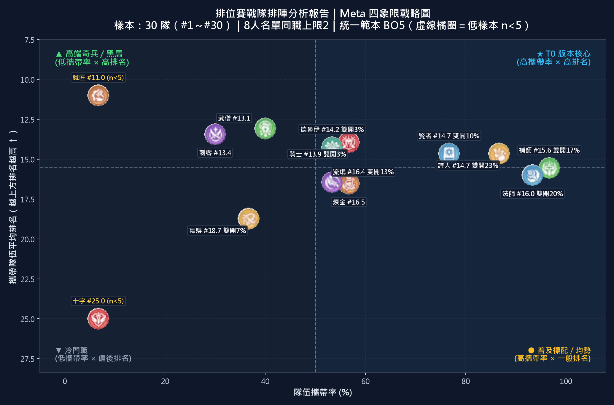
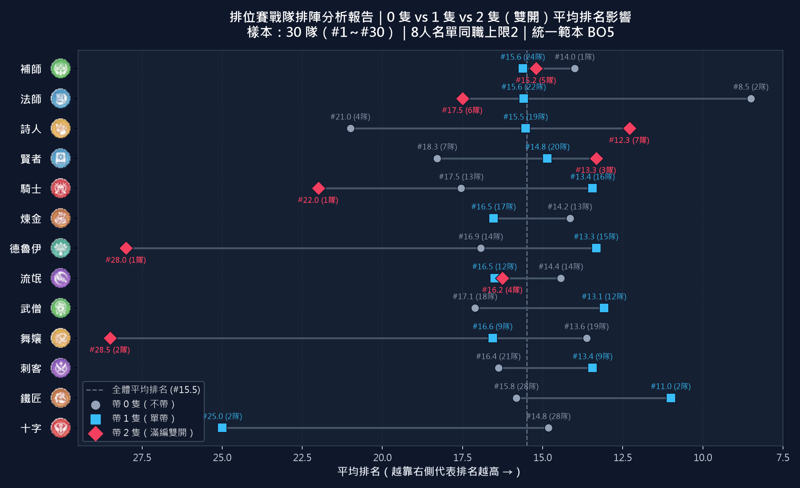
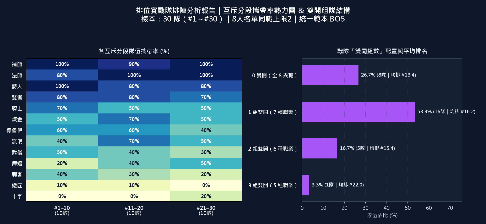
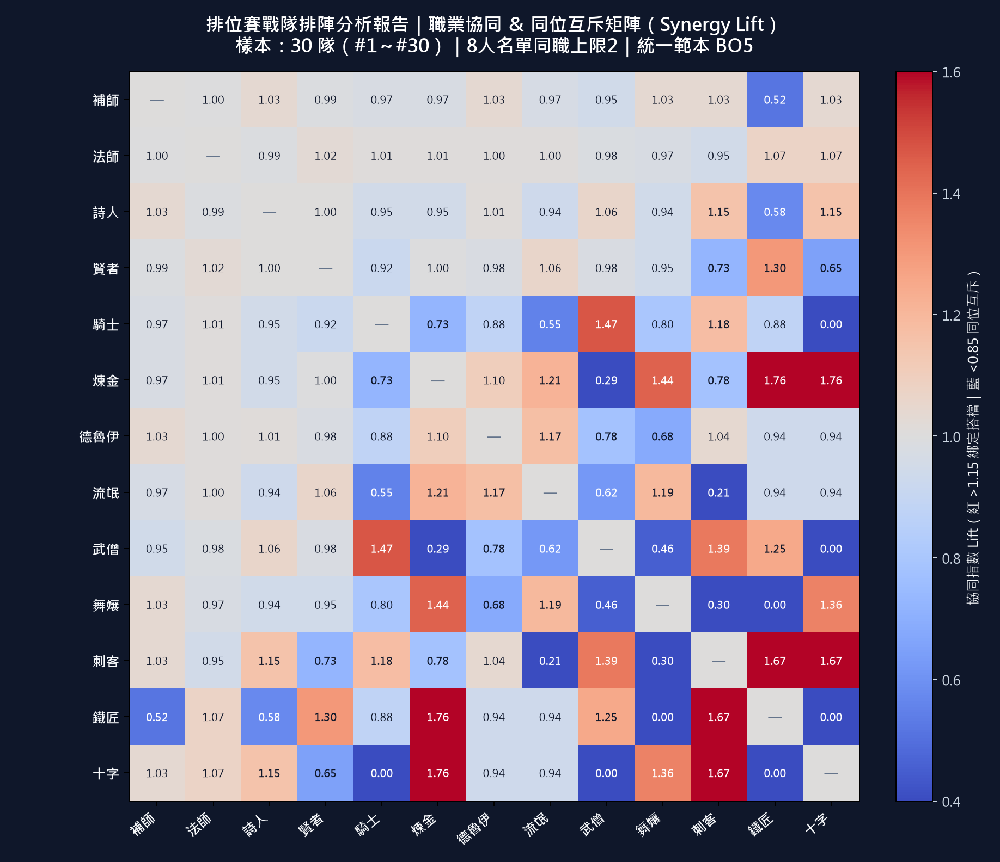

# Stage 4 深度學習筆記（v2 專業賽事排陣版）：賽制驅動分析、協同矩陣與多期追蹤

這份筆記對應 **Stage 4 v2（專為「統一範本・8人名單同職上限2・BO5 5v5/1v1/3v3/2v2/5v5」賽制設計的戰隊排陣統計與多期趨勢系統）**。

---

## 1. 專業分析師的第一課：先讀懂賽制，再設計統計指標！

在做資料分析時，最忌諱套用萬用模板而不看規則。加入你的賽制規則後，整個分析視角瞬間升級：
- **統一範本**：沒有裝備課金落差 → 排行榜名次高度反映「8人名單建構＋BO5 排兵＋操作」。
- **同職業上限 2 名**：三開是不合法的 → 直接把「同職 > 2」變成自動合規稽核（寫進 `Recognition Errors`），每個職業的決策聚焦在 **`0 隻` vs `1 隻` vs `2 隻（滿編雙開）`**！
- **積分隨賽程浮動**：跨天比較時積分基準會變，因此核心績效指標以**排名**為主，積分作為單期斷層輔助參考。

---

## 2. 四張王牌戰略圖背後的資料科學原理

### ① Meta 四象限戰略圖（`01_meta_quadrant.png`）

- **X 軸**：隊伍攜帶率（熱門度）；**Y 軸**：攜帶隊伍的平均排名（軸線反轉，越上方名次越高！）。
- **四象限定位**：
  - **右上（★ T0 版本核心）**：高攜帶率 × 高排名（必帶骨架，如詩人、賢者、騎士、德魯伊）。
  - **左上（▲ 高端奇兵 / 黑馬）**：低攜帶率 × 高排名（如武僧、刺客，高端局偷分利器）。
  - **右下（● 普及標配 / 均勢）**：大家都會帶但單靠它拉不開差距（如補師、法師）。
  - **左下（▼ 冷門職）**＋ **虛線橘圈（`n < 5` 低樣本警示）**：提醒戰隊別被只有 2 隊的極端均排誤導！

### ② 雙開投資效益圖（`02_copy_count_impact.png`）

- 針對 BO5 賽制「1v1 選手自動禁選 3v3/2v2」的痛點，直接比較每個職業帶 **`0 隻`（灰圓）**、**`1 隻`（藍方）**、**`2 隻`（紅菱）** 時的平均排名。
- 實測 30 隊一眼就能看出超猛洞見：**詩人**從 1 隻（`#15.5`）升級成雙開 2 隻（`#12.3`）名次大漲 **`+3.24 名`**；反之 **法師** 雙開（`#17.5`）反而比單帶（`#15.6`）略差！

### ③ 互斥分段熱力圖 ＋ 雙開組數結構（`03_tier_heatmap_and_doubles.png`）

- **為什麼改用互斥分段（`#1–10` / `#11–20` / `#21–30` 或 `#1–10` / `#11–50` / `#51–100` / `#101–200`）？** 避免 `Top 10` 被重複包進 `Top 50` 稀釋高低段差異！
- 右側同步統計戰隊「**總共配了幾組雙開（0 組＝全 8 異職 / 1 組 / 2 組 / 3 組）**」，幫隊長決定這季該走全功能瑞士刀還是雙核容錯。

### ④ 職業協同與同位互斥矩陣（`04_synergy_matrix.png`）

- **公式（Pairwise Synergy Lift）**：
  $$\text{Synergy}(A, B) = \frac{P(A \text{ 與 } B \text{ 同隊})}{P(A) \times P(B)}$$
- **消除假協同**：補師（97%）＋法師（93%）雖然同隊率 90%，但 `Synergy = 1.00`（純屬各自熱門，並非特殊連動）。
- **真正浮現的戰術流派**：
  - **深紅格（`> 1.15` 綁定搭檔）**：例如 **騎士 + 武僧（1.47x）**、**武僧 + 刺客（1.39x）**、**煉金 + 舞孃（1.44x）**。
  - **深藍格（`< 0.85` 同位互斥）**：例如 **流氓 vs 刺客（0.21x）**、**煉金 vs 武僧（0.29x）**、**騎士 vs 流氓（0.55x）**——實測數據自動幫你把整個伺服器切出了「點殺衝陣」與「消耗拉扯」兩大陣營！

---

## 3. 主流建隊流派（Roster Archetypes）與多期趨勢追蹤

1. **流派聚類（`src/analytics/stats.py` -> `_cluster_roster_archetypes`）**：
   - 把每隊轉成 13 維職業數量向量，做 L2 正規化後以 **Cosine 層次分群**自動歸納出 3～5 大建隊流派，提煉出每派的「核心必帶職＋常見搖擺位」。
2. **多期趨勢對比與換角偵測（`src/analytics/trends.py`）**：
   - 隨著賽程推進（Day 1 → Day 3 → Day 5 → 結算），透過正規化戰隊名稱跨期對齊，計算：
     - 各職業攜帶率與雙開率跨期漲跌（`presence_delta`）。
     - 每支戰隊的排名爬升軌跡（`net_rank_change`）。
     - **Multiset 陣容差集（`_diff_rosters`）**：精準偵測強隊中途「把哪個職業換成了哪個職業（如 `-刺客 +德魯伊`）」，以及換角前後的名次變化！

---

## 4. 關鍵程式碼閱讀順序
1. `src/analytics/stats.py` — 互斥分段、0/1/2 邊際效益、四象限、Synergy Lift 矩陣、流派聚類與同職上限 2 稽核
2. `src/analytics/trends.py` — 多期 Meta 漲跌、戰隊跨期排名追蹤與 Multiset 換角偵測
3. `src/export/share_cards.py` — 4 張專業戰隊圖卡（含圓形圖示嵌圖與智慧標籤防重疊）
4. `src/export/trend_export.py` — 多期趨勢 4 頁 Excel、折線/漲跌圖卡與互動網頁產生器
